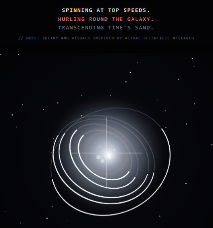

# 🛰️ THE MOORE SIGNAL ARCHIVE
### *Independent Citizen Science & Generative Art Log*

---

> ### **Bridging Earth to stars: The globe and cosmos as my canvas.**
> **Observer Code: MANBA** // Conceived by Angela N. Moore • Co-Engineered with AI Systems
> 
> The Moore Signal Archive is an autonomous, creative studio pairing open public domain data with minimalist art. As a privately run, independent archive, it contributes to collaborative citizen science research initiatives with no official ties to NASA or government space agencies.

---

### ⚙️ DIGITAL REPOSITORY // PROJECT GATEWAYS

  <table style="border: none; border-collapse: collapse; background: transparent; width: 100%; max-width: 580px; margin-left: 0;">
    <tr style="border: none;">
      <td align="left" style="border: none; padding: 6px 4px 6px 0; white-space: nowrap;">
        <a href="https://cyber-chic.github.io/cosmos/universe" style="text-decoration: none;"><b style="padding: 6px 12px; background-color: #21262d; border: 1px solid #30363d; border-radius: 6px; color: #58a6ff; font-size: 13px; display: inline-block;">🌌 3D GALAXY MAP</b></a>
      </td>
      <td align="left" style="border: none; padding: 6px 4px 6px 0; white-space: nowrap;">
        <a href="https://github.com/Cyber-Chic/cosmos/blob/main/COIN_LEDGER.md" style="text-decoration: none;"><b style="padding: 6px 12px; background-color: #21262d; border: 1px solid #30363d; border-radius: 6px; color: #58a6ff; font-size: 13px; display: inline-block;">🪙 COSMIC ARTIFACTS</b></a>
      </td>
      <td align="left" style="border: none; padding: 6px 4px; white-space: nowrap;">
        <a href="https://apps.aavso.org/exosite/?obscode=Manba&in_notes=&star_name=&exoplanet_name=&start_date=&end_date=&results_per_page=&search=true" style="text-decoration: none;"><b style="padding: 6px 12px; background-color: #21262d; border: 1px solid #30363d; border-radius: 6px; color: #58a6ff; font-size: 13px; display: inline-block;">📊 EXOPLANET GRAPHS</b></a>
      </td>
    </tr>
  </table>

> **Inside the Portal:** The interactive icons above provide direct access to featured directories. Launch my custom celestial 3D engine, trace hidden treasure hunt releases, or review my historical Exoplanet Watch light curves.

---

## 🔬 RESEARCH SCOPES & DATA VERIFICATION

*   📡 **Active Verification Records** — [Zooniverse Stats](https://www.zooniverse.org/groups/2959875?start_date=2026-08-16) \| [AAVSO Overview](https://archive.aavso.org/exoplanet-watch-pr) \| [AAVSO Profile](https://apps.aavso.org/v2/users/angela_moore/)
*   📊 **The Methodology** — Current research focus centers on aiding open-access astronomy projects, utilizing human pattern recognition to chart the cosmos via **[Zooniverse](https://www.zooniverse.org/about)**. Past exoplanet targets were modeled for **[Exoplanet Watch](https://science.nasa.gov/citizen-science/exoplanet-watch/exoplanet-watch-overview/)** using the **[EXOTIC](https://science.nasa.gov/citizen-science/exoplanet-watch/exotic/)** Python pipeline.
*   🛠️ **Studio Bookings & Contact** — `themoorearchive@proton.me` \| Official Hub: **[bio.site/mooresignal](https://bio.site/mooresignal)**

---

## 🌌 My Archived Exoplanets Ledger

These planet worlds represent historical tracking data processed, analyzed, and cataloged into open-access research databases:

*   **TrES Catalog** — <code style="color: #58a6ff;">TrES-2 b</code> • <code style="color: #58a6ff;">TrES-3 b</code> • <code style="color: #58a6ff;">TrES-5 b</code>
*   **Qatar Catalog** — <code style="color: #58a6ff;">Qatar-2 b</code>
*   **WASP Catalog** — <code style="color: #58a6ff;">WASP-10 b</code> • <code style="color: #58a6ff;">WASP-12 b</code> • <code style="color: #58a6ff;">WASP-49 b</code> • <code style="color: #58a6ff;">WASP-52 b</code> • <code style="color: #58a6ff;">WASP-140 b</code>

---

## 🎨 Creative Distribution & Space Manifests

  <table style="border: none; border-collapse: collapse; background: transparent;">
    <tr style="border: none;">
      <td align="center" style="border: none; padding: 0;">
        
         
        

          <i>Generative Visualizer Engine Snapshot (WASP-12b) Custom astropoetic verse rendered dynamically over a 3D celestial canvas.</i>
        

      </td>
    </tr>
  </table>

*   **Haiku Summaries** — Complex astronomical data sets are distilled into minimalist three-line poetry structures.
*   **Physical Artifacts** — Fragmented verses are hand-inscribed onto custom coins hidden globally within neighborhood art spaces. *[Join the cosmic hunt.](https://github.com/Cyber-Chic/cosmos/blob/main/COIN_LEDGER.md)*
*   **Space Missions** — Signature studio artwork is set for a live digital display via a [single satellite](https://tr.ee/P8Bv63Qkk6) passing over the **Pyramids**, while a collection of physical prints is actively queued to launch via [commercial rockets](https://www.clubforfuture.org/postcards).

---

<b>🛠️ Open Source & Attribution Protocol</b>

 

All astronomical data logged under the observer code `MANBA` is openly shared with the public domain to support global open science initiatives. 

Per standard AAVSO policy, if a professional research team incorporates these custom transit curves into a formal peer-reviewed study, standard academic attribution (Co-Author/Co-Investigator status) is required.

 

  🏢 <b>Administration:</b> The Moore Signal Archive LLC, Glastonbury, CT 06033

