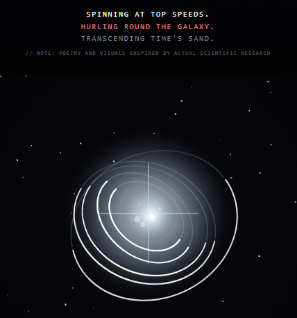

### **THE MOORE SIGNAL ARCHIVE™**
*Citizen-Science Astronomy & Astropoetic Data Log*  
<i>Observer Code: <b>MANBA</b> • Conceived by Angela N. Moore • Co-Engineered with AI Systems</i>

 

**[ ✦ 3D GALAXY MAP ](https://cyber-chic.github.io/cosmos/universe)** │ **[ ✦ COIN LEDGER ](https://github.com/Cyber-Chic/cosmos/blob/main/COIN_LEDGER.md)** │ **[ ✦ EXOPLANET GRAPHS ](https://apps.aavso.org/exosite/?obscode=Manba&in_notes=&star_name=&exoplanet_name=&start_date=&end_date=&results_per_page=&search=true)**

---

#### **✦ Research Overview**
**The Moore Signal Archive LLC** bridges citizen-science astronomy with cosmic poetry and visual art. While active research focuses on All-Sky classifications via **[Zooniverse](https://www.zooniverse.org/about)**, this repository also archives historical exoplanet transit curves modeled for **[Exoplanet Watch](https://science.nasa.gov/citizen-science/exoplanet-watch/exoplanet-watch-overview/)** using the **[EXOTIC](https://science.nasa.gov/citizen-science/exoplanet-watch/exotic/)** Python pipeline.

> *Note: Independent data-art archive utilizing public-domain astronomy datasets. Not affiliated with, funded by, or endorsed by NASA, AAVSO, or Zooniverse.*

---

### ✦ Data Verification & Observer Records
* **All-Sky Classifications** — Active pattern recognition & target logging [[Zooniverse Stats](https://www.zooniverse.org/groups/2959875?start_date=2026-08-16)]
* **Exoplanet Light Curves** — Historical transit photometry under code `MANBA` [[AAVSO Profile](https://apps.aavso.org/v2/users/angela_moore/)] • [[Program Info](https://archive.aavso.org/exoplanet-watch-pr)]
* **Studio & Inquiries** — `themoorearchive@proton.me` [[Studio Hub](https://bio.site/mooresignal)]

---

### ✦ Archived Exoplanets Ledger
Historical exoplanet transits processed, analyzed, and submitted to open-access AAVSO research databases:

* **TrES Catalog** — `TrES-2 b` • `TrES-3 b` • `TrES-5 b`
* **Qatar Catalog** — `Qatar-2 b`
* **WASP Catalog** — `WASP-10 b` • `WASP-12 b` • `WASP-49 b` • `WASP-52 b` • `WASP-140 b`

---

### ✦ From Data to Verse
Each observed target inspires an original three-line haiku mapped onto our interactive **[From Sirius to the Sun™](https://cyber-chic.github.io/cosmos/universe)** 3D starfield and hand-inked onto limited physical keepsakes tracked in the **[Coin Ledger](https://github.com/Cyber-Chic/cosmos/blob/main/COIN_LEDGER.md)**.

  <table>
    <tr>
      <td align="center">
        
          
        <i>Generative Visualizer Engine Snapshot (WASP-12b) Astropoetic verse rendered dynamically over a procedural 3D starfield.</i>
      </td>
    </tr>
  </table>

---

<b>▸ Open Source & Attribution Protocol (Click to Expand)</b>

 

All astronomical observations logged under observer code `MANBA` are shared openly to support public science initiatives. Per standard AAVSO policy, if a research team incorporates these custom transit curves into a formal peer-reviewed study, standard academic attribution (Co-Author / Co-Investigator credit) is required.

 

**The Moore Signal Archive LLC** • Glastonbury, CT 06033  
Return to the main **[GitHub Profile Dashboard](https://github.com/cyber-chic)**.

