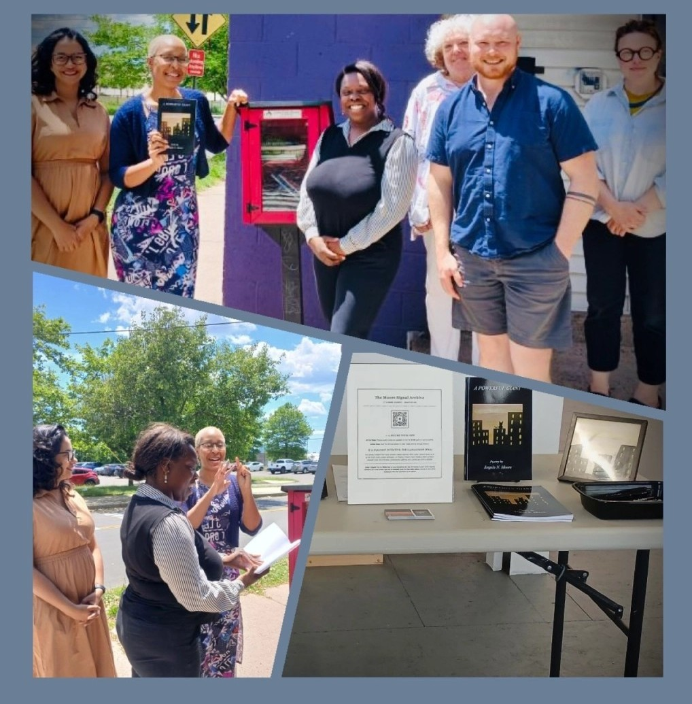
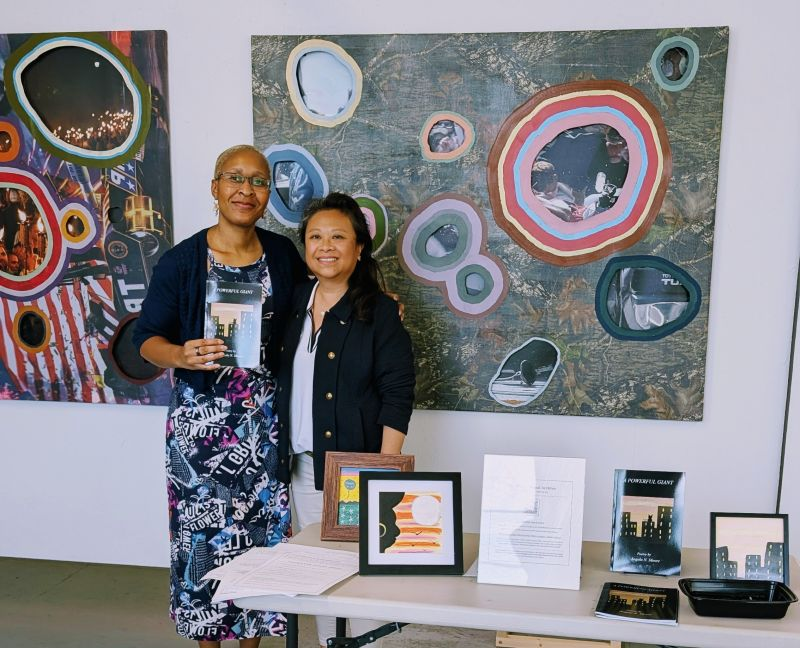
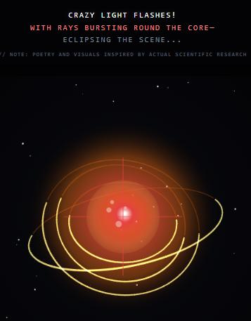

# 🛰️ MOORE SIGNAL // EXHIBIT SPOTLIGHT

---

### 📜 THE PROGRAMME

> **COSMIC SHOWCASE** — Our upcoming orbital exhibition will broadcast original artwork directly over the Pyramids of Giza via satellite, debuting alongside limited-edition physical prints destined for space flight.
> 
> **THE ARCHIVE** — This page preserves the extended spacebound art collection. These digital captures are compiled as physical prints actively queued to launch into space aboard commercial rockets via **[Blue Origin](https://www.clubforfuture.org/postcards)**. To track the real-world token hunt, return to the main **[HUB](https://github.com/Cyber-Chic/cosmos/blob/main/COIN_LEDGER.md)**.

---

### 🎨 PHASE 1 // THE CELESTIAL STAGE

#### 🛰️ BROADCAST TRANSMISSION // **[SAT GUS](https://space.crunchlabs.com/selfie/VnpvzMO)**
*   **Target Profile** — Low Earth Orbit Satellite Broadcast
*   **Medium & Format** — Mixed-Media Composition // Flagship Artifact
*   **Exhibition Status** — `🟢 QUEUED FOR BROADCAST`

 

  
  
<i>Archival Artifacts (Full Composition) — Slated to broadcast over the Pyramids of Giza.  Fragmented poetry traces the verso side of each corresponding physical token.</i>

---

### 📷 PHASE 2 // POP-UP FEATURES & HISTORY

#### 📂 ARCHIVE DOCUMENTATION // **[SNAP-CTTW-001](https://luma.com/q0lm15pz)**
*   **Provenance** — Ely Center for Contemporary Art *(CT Tech Week Pop-Up)*
*   **Exhibition Status** — `🔵 ACTIVE QUEUE // FLIGHT INTEGRATION`

  
   
  <i>Founder Angela N. Moore presents the official Moore Signal book release to an engaged audience. Ely Center Director Aimée Burg is pictured on the far right.  <b>Image Credit:</b> Courtesy of Ely Center for Contemporary Art</i>

---

#### 📂 ARCHIVE DOCUMENTATION // **[SNAP-CTTW-002](https://www.linkedin.com/posts/promanow_cttechweek-women-innovation-ugcPost-7468021297931825152-XZgR/)**
*   **Provenance** — Ely Center for Contemporary Art *(CT Tech Week Pop-Up)*
*   **Exhibition Status** — `🔵 ACTIVE QUEUE // FLIGHT INTEGRATION`

  
   
  <i>Archive Founder Angela N. Moore alongside Prakaithip Romanow, Director of Manufacturing AI, celebrating the Moore Signal project debut hosted at Ely Center.  <b>Image Credit:</b> Courtesy of Ely Center for Contemporary Art</i>

---

### 🌌 PHASE 3 // THE GALAXY CAPTURES

#### 🪐 COSMIC DATA LOG // **[TrES-3b](https://en.wikipedia.org/wiki/TrES-3b)**
*   **Data Inspiration** — — Transiting Exoplanet Data Analysis *(Exoplanet Watch Project)*
*   **Medium & Format** — Generative Art Engine // Procedural Celestial Canvas
*   **Exhibition Status** — `🔵 ACTIVE QUEUE // FLIGHT INTEGRATION`

 

  
  
<i>Astro-Poetry Verse: “Spinning at top speeds....”  Generative visualizer snapshot: Original verse mapped over a procedural deep sky environment.</i>

---

#### 🪐 COSMIC DATA LOG // **[TARGET: WASP-12b](https://simple.wikipedia.org/wiki/WASP-12b)**
*   **Data Inspiration** — Transiting Exoplanet Data Analysis *(Exoplanet Watch Project)*
*   **Medium & Format** — Generative Art Engine // Procedural Celestial Canvas
*   **Exhibition Status** — `🔵 ACTIVE QUEUE // FLIGHT INTEGRATION`

 

  
  
<i>Astro-Poetry Verse: “Raging hot flames reign....”  Generative visualizer snapshot: Original verse mapped over a procedural deep sky environment.</i>

---

#### 🪐 COSMIC DATA LOG // **[TARGET: SKY-DATA](https://www.zooniverse.org/projects?discipline=astronomy)**
*   **Data Inspiration** — Deep-Space Anomaly Tracking *(Zooniverse Platform)*
*   **Medium & Format** — Generative Art Engine // Procedural Celestial Canvas
*   **Exhibition Status** — `🔵 ACTIVE QUEUE // FLIGHT INTEGRATION`

 

  
  
<i>Astro-Poetry Verse: “Crazy light flashes....”  Generative visualizer snapshot: Original verse mapped over a procedural deep sky environment.</i>

