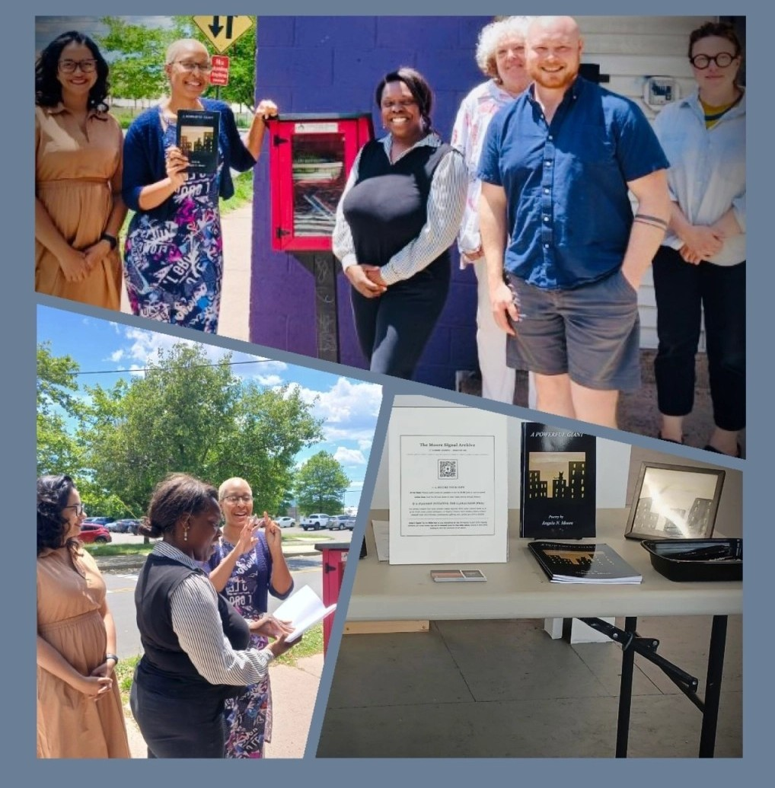
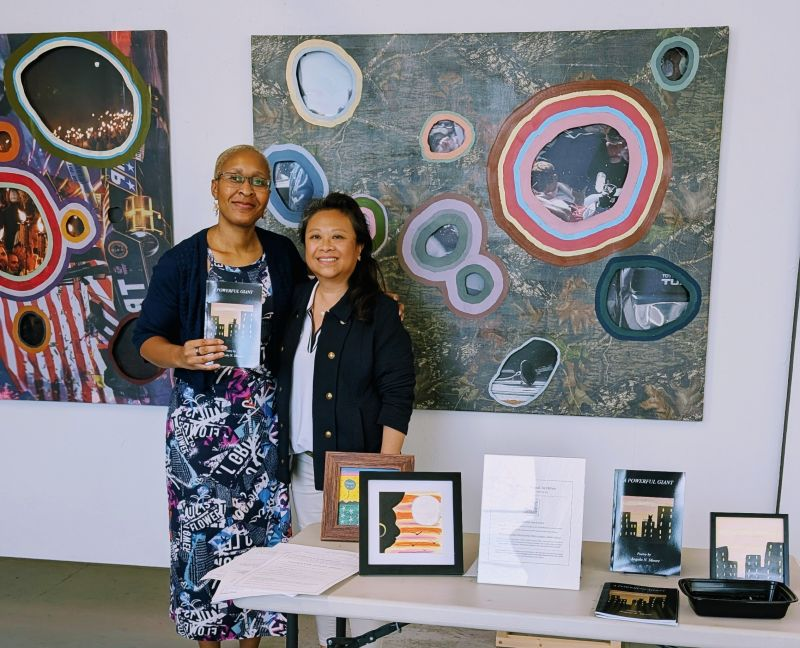
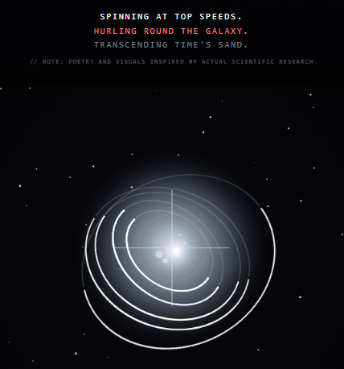
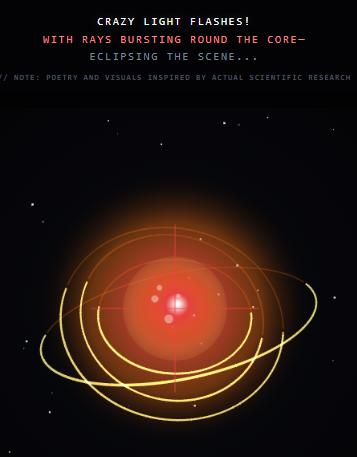

### **THE MOORE SIGNAL ARCHIVE™**
*Exhibit Spotlight & Spacebound Art Catalogue*

**[ ✦ COIN LEDGER ](https://github.com/Cyber-Chic/cosmos/blob/main/COIN_LEDGER.md)** │ **[ ✦ 3D GALAXY MAP ](https://cyber-chic.github.io/cosmos/universe)** │ **[ ✦ STUDIO HUB ](https://bio.site/mooresignal)**

---

### ✦ The Programme

> **Cosmic Showcase** — Our upcoming orbital exhibition will broadcast original artwork directly over the Pyramids of Giza via satellite, debuting alongside limited-edition physical prints destined for spaceflight.
> 
> **The Archive** — This catalogue preserves the extended spacebound art collection. Select captures are compiled as physical prints queued for spaceflight aboard commercial rockets via **[Blue Origin](https://www.clubforfuture.org/postcards)**. To track the real-world token hunt, visit the **[Coin Ledger](https://github.com/Cyber-Chic/cosmos/blob/main/COIN_LEDGER.md)**.

---

### ✦ Phase 1 // The Celestial Stage

#### Broadcast Transmission — **[Sat Gus](https://space.crunchlabs.com/selfie/VnpvzMO)**
* **Target Profile** — Low Earth Orbit Satellite Broadcast
* **Medium & Format** — Mixed-Media Composition • Photograph
* **Exhibition Status** — `QUEUED FOR BROADCAST`

  <table>
    <tr>
      <td align="center">
        
          
        <i>Archival Artifacts (Full Composition) — Slated to broadcast over the Pyramids of Giza. Fragmented poetry traces the reverse side of each corresponding physical token.</i>
      </td>
    </tr>
  </table>

---

### ✦ Phase 2 // Pop-Up Features & History

#### Exhibition Log — **[SNAP-CTTW-001](https://luma.com/q0lm15pz)**
* **Provenance** — Ely Center for Contemporary Art *(CT Tech Week Pop-Up)*
* **Exhibition Status** — `QUEUED • PREPARING FOR LAUNCH`

  <table>
    <tr>
      <td align="center">
        
          
        <i>Founder Angela N. Moore presents the official Moore Signal book release at the Ely Center. Ely Center Director Aimée Burg is pictured on the far right. (Photo courtesy of Ely Center for Contemporary Art)</i>
      </td>
    </tr>
  </table>

---

#### Exhibition Log — **[SNAP-CTTW-002](https://www.linkedin.com/posts/promanow_cttechweek-women-innovation-ugcPost-7468021297931825152-XZgR/)**
* **Provenance** — Ely Center for Contemporary Art *(CT Tech Week Pop-Up)*
* **Exhibition Status** — `QUEUED • PREPARING FOR LAUNCH`

  <table>
    <tr>
      <td align="center">
        
          
        <i>Founder Angela N. Moore alongside Prakaithip Romanow, Director of Manufacturing AI, celebrating the studio debut. (Photo courtesy of Ely Center for Contemporary Art)</i>
      </td>
    </tr>
  </table>

---

### ✦ Phase 3 // The Galaxy Captures

#### Cosmic Data Log — **[TrES-3b](https://en.wikipedia.org/wiki/TrES-3b)**
* **Data Inspiration** — Exoplanet Transit Modeling *(Exoplanet Watch)*
* **Medium & Format** — 3D Poetry Engine • Rotating Celestial Canvas
* **Exhibition Status** — `QUEUED • PREPARING FOR LAUNCH`

  <table>
    <tr>
      <td align="center">
        
          
        <i>Cosmic Poetry: “Spinning at top speeds....” Original verse mapped over a rotating 3D starfield.</i>
      </td>
    </tr>
  </table>

---

#### Cosmic Data Log — **[WASP-12b](https://simple.wikipedia.org/wiki/WASP-12b)**
* **Data Inspiration** — Exoplanet Transit Modeling *(Exoplanet Watch)*
* **Medium & Format** — 3D Poetry Engine • Rotating Celestial Canvas
* **Exhibition Status** — `QUEUED • PREPARING FOR LAUNCH`

  <table>
    <tr>
      <td align="center">
        
          
        <i>Cosmic Poetry: “Raging hot flames reign....” Original verse mapped over a rotating 3D starfield.</i>
      </td>
    </tr>
  </table>

---

#### Cosmic Data Log — **[Daily Minor Planet](https://www.zooniverse.org/projects/fulsdavid/the-daily-minor-planet/talk/subjects/105418882)**
* **Data Inspiration** — All-Sky Astronomy *(Zooniverse)*
* **Medium & Format** — 3D Poetry Engine • Rotating Celestial Canvas
*** **Exhibition Status** — `ACTIVE QUEUE • FLIGHT INTEGRATION`**

  <table>
    <tr>
      <td align="center">
        
          
        <i>Cosmic Poetry: “Crazy light flashes....” Original verse mapped over a rotating 3D starfield.</i>
      </td>
    </tr>
  </table>

---

  <i>© 2026 The Moore Signal Archive LLC • Glastonbury, CT • Return to <a href="https://github.com/cyber-chic">Main Profile</a></i>

